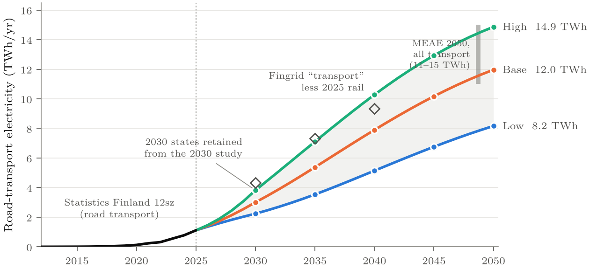
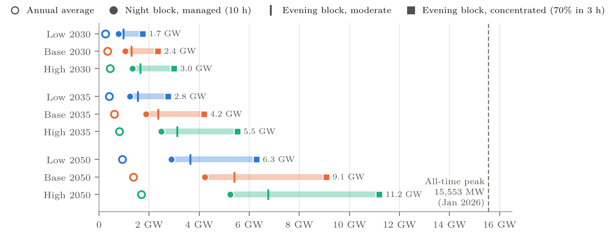

# Road Transport Electrification in Finland — Electricity Scenarios to 2050

[](https://doi.org/10.5281/zenodo.24106473)
[](https://creativecommons.org/licenses/by/4.0/)
[](LICENSE.txt)

**Is road transport still a secondary energy load but a first-order grid and flexibility issue in 2050, when most cars, vans, buses and many trucks are electric?**

This repository contains the paper source, stock-flow model and full outputs for *Road Transport Electrification in Finland: Electricity Consumption Scenarios to 2050 and Power-Market Implications* (Merilehto, 2026; [doi:10.5281/zenodo.24106473](https://doi.org/10.5281/zenodo.24106473)). The model follows electric vehicles by segment (cars, plug-in hybrids, vans, regional and long-haul trucks, buses), calibrated to Statistics Finland's 2025 road-transport electricity of 1,112 GWh.

The low / base / high cases are **assumed planning states**, not forecasts.

---

## Key results



| State | 2030 | 2035 | 2050 | 2050 average load | 2050 winter charging blocks: managed night → concentrated evening | Difference of blocks |
|---|---|---|---|---|---|---|
| **Low** | 2.24 TWh | 3.54 TWh | 8.16 TWh | 0.93 GW | 2.9 → 6.3 GW | 3.4 GW |
| **Base** | 3.01 TWh | 5.38 TWh | 11.96 TWh | 1.37 GW | 4.2 → 9.1 GW | 4.8 GW |
| **High** | 3.82 TWh | 7.11 TWh | 14.86 TWh | 1.70 GW | 5.2 → 11.2 GW | 5.9 GW |

The charging blocks are illustrative and occur at different hours (night vs evening); their difference is not a modelled reduction of the national peak.

- **Secondary against the national total.** In 2050 road transport is 4.5–11% of national final electricity consumption in the Long-term Climate Plan's 2050 scenarios (134–180 TWh; Base 7–9%).
- **Also secondary against data centres.** About 4.5 GW of data centres under construction and over 11 GW announced correspond to roughly 25–62 TWh a year; 2050 road transport is 13–59% of that. The ministry's own assumption of just over 10 TWh in three of its 2050 scenarios is below what is already being built.
- **Timing decides the power footprint.** The concentrated evening block equals 40–72% of the January 2026 consumption record (15,553 MW).
- **Rebound is a design constraint.** A synchronised restart after a four-hour curtailment lifts Base light-duty charging to 13 GW with well-equipped chargers; with weaker equipment, full recovery takes 7–10 hours and does not fit a ten-hour night.
- **Heavy vehicles are a connection problem.** They use 13–20% of the 2050 energy, but a 100-bus depot draws 2.4–13.5 MW depending on charger sequencing; national corridor charging peaks at 75–354 MW (60–300 megawatt chargers at full power).
- **Robustness.** A genuine 10-year adoption delay lowers 2050 Base by 19%; adoption stalled from 2030 lowers it by 31%. The largest one-way effects are electricity use per light-duty EV and the calibration to the official statistic (each about −1.5 TWh).



---

## What the model does

1. **Reproduces its starting point.** Every published number behind the 2030 states is recomputed from its stated inputs, and the script stops if any differ.
2. **Calibrates to 2025.** Gross electric cohorts 2012–2025 are backed out of Statistics Finland's vehicle stock (11ie) so that survivors reproduce the observed stocks; mileage by age is anchored to traffic performance (12jx); a single light-duty factor reproduces the 1,112 GWh in 12sz.
3. **Retains the 2030 states exactly.** One parameter per state, light-duty electricity per EV in 2030, is solved so that 2030 equals 2.24 / 3.01 / 3.82 TWh.
4. **Builds 2030–2050 by stock-flow.** Electric shares of fleet entries follow logistic paths to state-specific ceilings set by EU CO₂ rules for cars, vans and heavy-duty vehicles; cohorts survive on Weibull curves.
5. **Converts energy to load.** Average MW; illustrative winter evening and night charging blocks; depot and corridor loads for heavy vehicles.
6. **Runs robustness tests:**
   - one-way sensitivity (tornado);
   - genuine adoption delay (shifted, not renormalised);
   - stalled adoption;
   - charging-behaviour stress;
   - rebound after curtailment;
   - top-down national and Nordic checks;
   - materiality against Fingrid's ranges, the ministry's 2050 scenarios, the 2026 peak record and data-centre references.

---

## Repository layout

```
├── paper/
│   ├── main.tex            # manuscript (arXiv-style LaTeX)
│   ├── main.bbl            # compiled bibliography (arXiv needs it)
│   ├── references.bib
│   ├── tables/             # tables generated by model/tables.py
│   └── figures/            # figure PDFs generated by model/figures.py
├── model/
│   ├── model.py            # stock-flow model, standard library only
│   ├── tables.py           # writes paper/tables/
│   └── figures.py          # writes paper/figures/ and docs/
├── data/
│   ├── inputs/             # 2030 input CSV (StatFin 12sz), unchanged
│   ├── sources/            # Statistics Finland extracts of 8 Nov 2026 (12sz, 11ie, 12jx)
│   ├── paths.csv           # annual 2025–2050 paths, every state
│   ├── results.csv         # 2025 / 2030 / 2035 / 2040 / 2045 / 2050 checkpoints
│   ├── materiality.csv, heavy_connections.csv, sites.csv
│   ├── tornado.csv, delay.csv, stalled.csv, robustness_paths.csv
│   ├── charging_stress.csv, rebound.csv, topdown.csv
│   └── calibration.csv, stock_check.csv, car_entry_shares.csv, boundary_statfin.csv, reproduction_2030.csv
├── docs/                   # README images
├── LICENSE.txt
└── CITATION.cff
```

## Reproduce

Windows PowerShell with conda, from the repository root:

```powershell
conda create -n road2050 python=3.11 matplotlib -y
conda activate road2050

python model\model.py        # writes data\*.csv; asserts the 2030 reproduction, 2025 calibration and 2030 retention
python model\tables.py       # writes paper\tables\*.tex
python model\figures.py      # writes paper\figures\*.pdf and docs\*.png
cd paper; latexmk -pdf main.tex
```

`model.py` and `tables.py` use only the Python standard library. The figures use Latin Modern if it is installed and fall back to the matplotlib default otherwise.

---

## Citation

```bibtex
@techreport{merilehto2026road2050,
  author      = {Merilehto, Juhani},
  title       = {Road Transport Electrification in {Finland}: Electricity Consumption
                 Scenarios to 2050 and Power-Market Implications},
  year        = {2026},
  institution = {Zenodo},
  doi         = {10.5281/zenodo.24106473},
  url         = {https://doi.org/10.5281/zenodo.24106473}
}
```

GitHub's **Cite this repository** button uses `CITATION.cff`.

## Earlier work

This study extends an earlier analysis to 2030 ([doi:10.5281/zenodo.21078010](https://doi.org/10.5281/zenodo.21078010)), whose 2030 states it retains.

## Licence

Paper text, figures and data: [CC BY 4.0](https://creativecommons.org/licenses/by/4.0/). Python code: MIT. See [LICENSE.txt](LICENSE.txt).

The analysis and views are solely the author's and do not represent any employer or affiliated institution.
